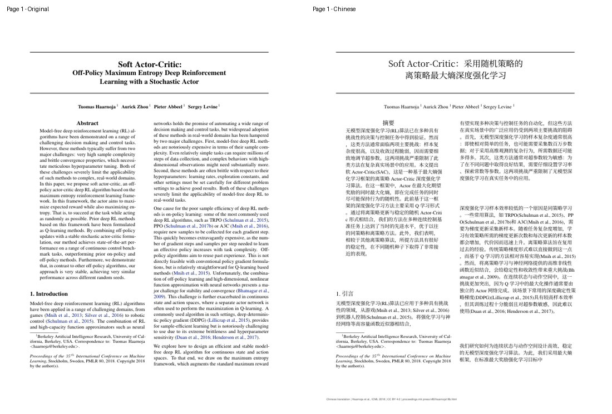
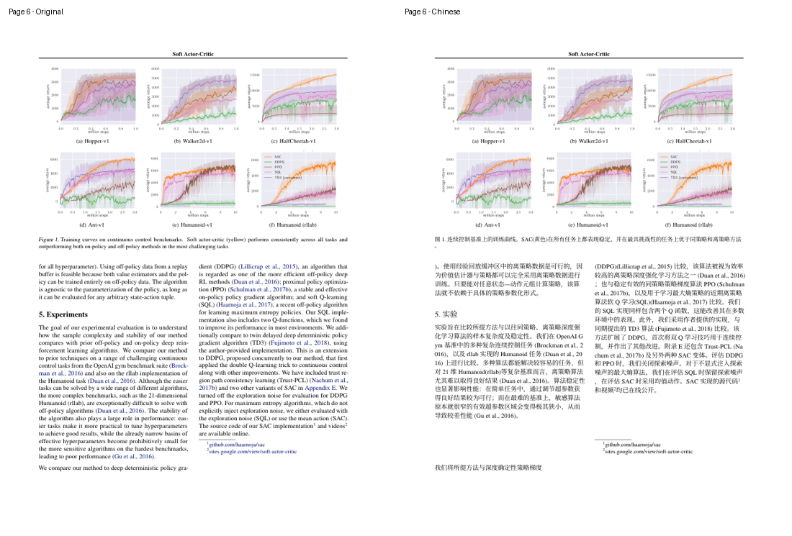
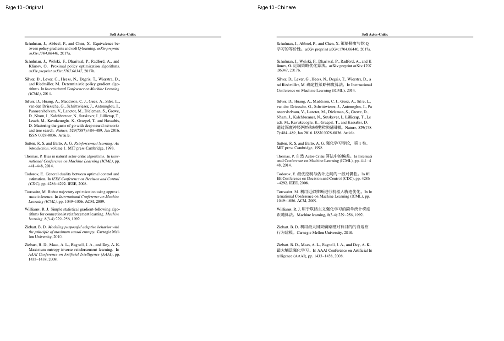

# SAC 翻译与排版检查

检查日期：2026-10-25。处理对象是 ICML 2018 正式发表版的全部 10 页。

## 来源与署名

Haarnoja, T., Zhou, A., Abbeel, P. & Levine, S. (2018). *Soft Actor-Critic: Off-Policy Maximum Entropy Deep Reinforcement Learning with a Stochastic Actor*. Proceedings of Machine Learning Research, 80:1861-1870.

- [PMLR 论文页面](https://proceedings.mlr.press/v80/haarnoja18b.html)
- [原文 PDF](https://proceedings.mlr.press/v80/haarnoja18b/haarnoja18b.pdf)
- [PMLR 出版协议](https://proceedings.mlr.press/pmlr-license-agreement.pdf)：CC BY 4.0。
- 中文文件属于翻译和排版改编，保留原作者、会议、来源及许可信息。

## 翻译方式

采用 [AIKONG2024/paper-translate-agent-skill](https://github.com/AIKONG2024/paper-translate-agent-skill/tree/main/pdf-translate)。当前对话模型完成 117 个文本单元的翻译，skill 在本地保存、回填并验收 PDF；最终流程不调用额外翻译服务或模型 API，不需要用户另配密钥。本地排版使用 PDFMathTranslate 1.9.11，按 Windows 路径和现有缓存作了兼容调整。

正文、标题、图注、定理说明、致谢和参考文献题名已翻译；作者姓名、出版物名称、图内英文标签和算法伪代码保留。公式、编号、曲线和原始矢量图保持原貌。参考文献仍可按原始书目信息定位。

## 检查结果

| 文件 | 页数 | 内容 |
|---|---:|---|
| `original/SAC_ICML18.pdf` | 10 | PMLR 原文，未改动 |
| `translated/SAC_ICML18-mono.pdf` | 10 | 原页布局内嵌中文 |
| `translated/SAC_ICML18-dual.pdf` | 20 | 英文原页、中文译页交替配对 |

- PDF 结构、可解析性、加密状态、页数、页面尺寸、非空文本和首/中/尾页预览检查通过。
- 117 个单元逐项核对来源哈希、公式占位符数量、数字标记，以及规范化后的作者年份引用，均一致。
- 中文版每页均有中文文本；实际提取确认 Source Han Serif CN Regular 字体已嵌入。
- 完成全部 10 页图像检查。修正首页标题断词、附录 B.1 的证明提示和署名脚注；从原文恢复三幅完整矢量图，保留旋转的纵轴文字、图例及刻度。
- 最终验收仍有 3 条引用标记提示，均来自原文跨行断词：`Schul- man`、`Brock- man`、`Lill- icrap`。去掉断词并规范化空白后，作者年份引用全部匹配。

此处对应含独立状态价值网络的 2018 年 SAC。附录仅保留正文中的引用，单独发布的补充材料未包含在本次 10 页翻译内。图 3(b) 原文的 `lower entries` 依照奖励缩放与熵的上下文译为较低的熵。

三份文件的 SHA-256 校验值已加入 [SHA256SUMS.txt](SHA256SUMS.txt)。

## 首、中、尾页预览

左侧为原文，右侧为中文。

